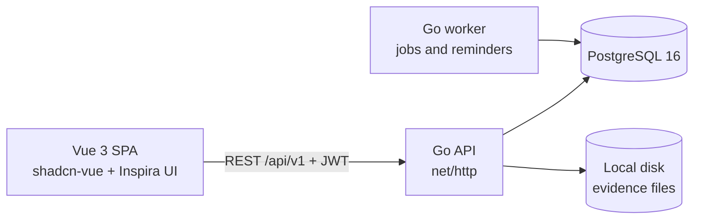
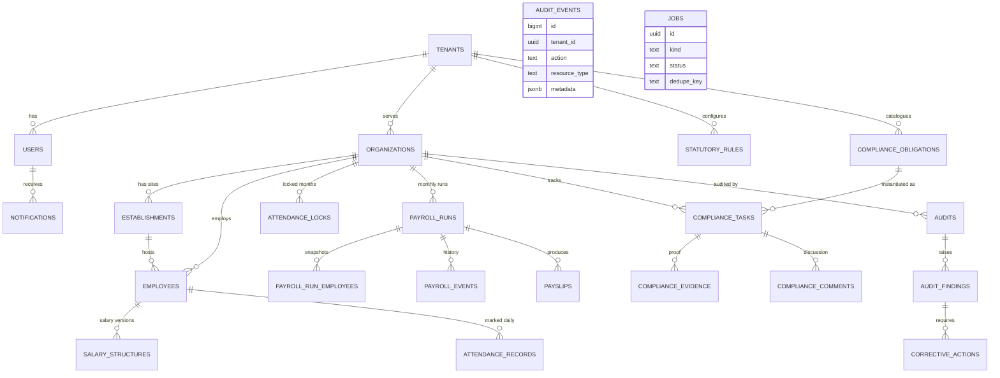
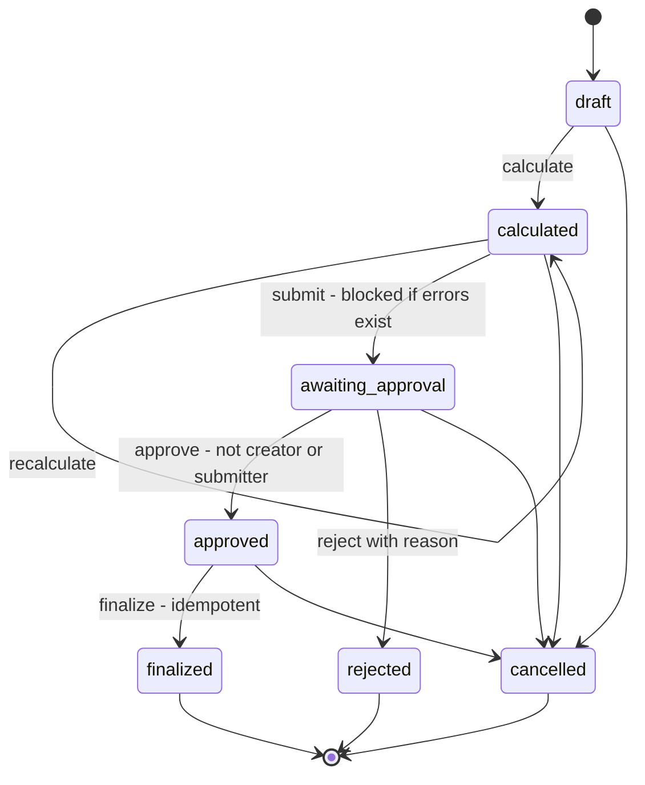
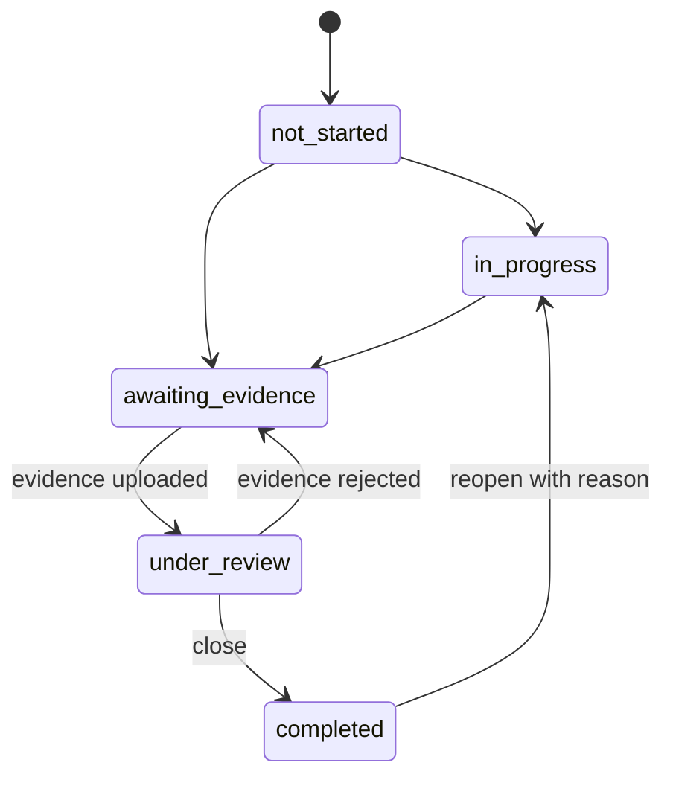

<div align="center">

# ComplyHub

**An HR compliance and payroll portal for service providers that run payroll and statutory compliance for many client organizations.**


</div>

> **Demo application with fictional data.** Every company, person, number and rule in this repository is made up. Statutory values (PF, ESI and others) are demonstration configuration, **not legal advice**, and must be reviewed by a qualified professional before any real use.

---

## Contents

[What it is](#what-it-is) · [Engineering highlights](#engineering-highlights) · [Architecture](#architecture) · [Data model](#data-model) · [Business rules](#business-rules) · [Security and roles](#security-and-roles) · [Background worker](#background-worker) · [API](#api) · [Frontend](#frontend) · [Getting started](#getting-started) · [Testing](#testing) · [Demo walkthrough](#demo-walkthrough) · [Design decisions](#design-decisions) · [Known limitations](#known-limitations)

---

## What it is

A service provider (the **tenant**) manages payroll and statutory compliance for several **client organizations**. Each organization has **establishments** (sites in different Indian states) and **employees**.

Staff run the monthly cycle end to end:

1. **Attendance**: mark it, then lock the month.
2. **Payroll**: calculate, submit, approve (maker-checker), finalize, issue payslips.
3. **Compliance**: generate recurring tasks, upload evidence, review it, close or reopen.
4. **Audit**: plan audits, record findings, assign corrective actions, verify them before anything is closed.
5. A background **worker** raises overdue reminders.

Everything is **tenant-isolated** and **auditable**.

**At a glance**

| | |
| --- | --- |
| Backend | Go modular monolith: `api`, `worker` and `seed` binaries |
| Database | PostgreSQL 16, 23 tables, integrity enforced in the database as well as in Go |
| Roles / permissions | 5 roles, 19 permissions, checked in middleware |
| Frontend | Vue 3 + TypeScript, 25 pages, permission-aware UI |
| Tests | 24 groups: unit, database, API workflow, concurrency, worker |
| Runtime dependencies | PostgreSQL only (no Redis, no S3, no message broker) |

---

## Engineering highlights

The interesting part of this project is not the number of screens. It is that the rules which must never break are **enforced in more than one place and proven by a test**.

| Rule that must never break | How the code enforces it | Proven by |
| --- | --- | --- |
| A tenant can never see or change another tenant's data | `tenant_id` comes only from the verified JWT. Every SQL statement filters by it. Composite foreign keys `(child_id, tenant_id)` make cross-tenant links impossible. Another tenant's resource returns **404**, never 403, so existence is not leaked. | One tenant-isolation test per module |
| A payroll run cannot be approved by the person who created or submitted it | Maker-checker rule in the service, plus a conditional `UPDATE ... WHERE status = 'awaiting_approval'` | Workflow test, plus 20 goroutines approving one run: exactly one `200`, the rest `409` |
| Finalizing twice is harmless | One transaction with `SELECT ... FOR UPDATE`. An already finalized run returns `200` unchanged, with no new events and no new payslips. | 20 goroutines finalize one run: every response is `200`, exactly one finalize event, payslip count equals employee count |
| Finalized payroll never changes | Results are **snapshots** (salary structure copied into each row). A database trigger rejects updates and deletes on a finalized run's rows. | A later salary edit leaves finalized rows unchanged, and a direct SQL update fails |
| Salary versions never overlap | `EXCLUDE USING gist` on `(employee_id, daterange(...))` | Overlapping structure returns `409` |
| Only one live payroll run per organization per month | Partial unique index that ignores rejected and cancelled runs | Constraint test |
| Background work is never done twice | `FOR UPDATE SKIP LOCKED` claiming, unique `dedupe_key`, idempotent handlers | Two workers on 50 jobs process none twice. `overdue_scan` run twice creates the same notifications. |
| Money is never wrong by a paisa | `int64` paise everywhere (Go, SQL, JSON, TypeScript), explicit half-up and ceiling helpers, no floats | Five hand-computed payroll vectors, plus string-based money parsing in the UI |
| History cannot be rewritten | `audit_events` and `payroll_events` are append-only through database triggers | Trigger tests |
| A finding cannot be closed without proof | Needs at least one corrective action, all closed. The verifier must differ from the action owner. | Audit flow test |
| Uploaded evidence is treated as hostile | Server-side type detection (PDF, PNG, JPEG only), 5 MiB limit, SHA-256 stored, sanitized display name, `nosniff` on download | Evidence validator tests |

---

## Architecture



**Layer rules**

- `handler.go` handles HTTP only: no SQL and no business rules.
- `service.go` holds the use cases and transactions.
- `repository.go` holds hand-written SQL through pgx. There is **no ORM**.
- `domain.go` holds pure business rules and imports neither `net/http` nor `pgx`.
- Dependencies come in through constructors. There is no global mutable state.
- A module never reads another module's tables. It calls that module's service interface.

**Repository layout**

```text
complyhub/
  backend/
    cmd/api/            HTTP API
    cmd/worker/         background worker
    cmd/seed/           idempotent demo data, loaded through the application services
    internal/
      platform/         config, db (pool + WithTx), httpx (router, envelope, middleware), auth, logger
      shared/           money (int64 paise), clock (Asia/Kolkata, fixable in tests)
      modules/          identity, organization, workforce, attendance, payroll,
                        compliance, audit, notifications, jobs, reports, dashboard
    migrations/         ordered *.up.sql / *.down.sql, embedded in the binary
    docs/modules/       four lines per module: problem, rule, enforcement, proving test
    Dockerfile  Makefile  go.mod
  frontend/
    src/
      api/              typed client, one file per backend module
      components/       ui (shadcn-vue), inspira (decorative), app (shared)
      layouts/ pages/ router/ stores/ composables/ lib/
  docker-compose.yml    postgres, api, worker
  .env.example
  PROGRESS.md
  openapi.yaml
```

---

## Data model

23 tables. UUID primary keys, `timestamptz` for event times, `date` for business dates, money as `bigint` paise. Every business table carries `tenant_id`.



**Integrity is enforced by the database, not only by Go**

- **Composite foreign keys** such as `(organization_id, tenant_id)` make it impossible to attach a child row to another tenant's organization.
- **Exclusion constraints** (`btree_gist`) prevent overlapping salary versions and overlapping statutory rule periods.
- **Partial unique index** allows one live payroll run per organization and month, while rejected and cancelled runs do not block a new one.
- **Triggers** make `audit_events` and `payroll_events` append-only, and make a finalized run's `payroll_run_employees` immutable.
- **CHECK constraints** cover status values, date ordering (exit not before joining), and `bank_account_last4` (digits only, four at most). Only the last four digits of a bank account are ever stored.
- **Derived, never stored:** `overdue` is computed as `due_date < today AND status <> 'completed'`.

---

## Business rules

### Payroll calculation

A pure function (`payroll.Calculate`) with no database access. Statutory parameters are **data**, read from effective-dated, approved `statutory_rules` rows. If a required PF or ESI rule is missing for the date, the calculation fails with a clear error instead of guessing.

Per employee, for an (organization, month):

1. Eligible employees joined on or before the period end and have not exited before the period start.
2. The salary structure used is the one effective on the earlier of the period end and the exit date. A missing structure is a blocking issue.
3. Every employed day needs an attendance record. Unmarked days are a blocking issue.
4. Paid days are counted in **half-days** (integers): present, leave, weekly off and holiday count as 2, half-day as 1, absent as 0.
5. Each component is prorated with integer arithmetic, rounded half up.
6. **50% wage rule:** HRA and conveyance count towards wages only up to half of earned gross. The rest is added back to the wage base.
7. **PF:** wage base capped at the ceiling, then employee and employer shares in basis points, rounded to the nearest rupee.
8. **ESI:** applies only if the full-month contractual gross is within the ceiling. Shares are rounded **up** to the next rupee.
9. `net = earned gross - employee PF - employee ESI`. Employer contributions are shown separately and are not deducted from pay.
10. The structure used and any issues are stored per employee row, and the rules used are stored on the run (`rules_snapshot`).

Worked examples (these are the required test vectors):

| Case | Structure (₹ / month) | Paid / days | Result |
| --- | --- | --- | --- |
| A | Basic 9,000, HRA 9,000 | 30 / 30 | Earned gross 18,000. PF wages 9,000. Employee PF 1,080, employer PF 1,080. ESI 135 / 585. **Net 16,785.** |
| B | Same as A | 15 / 30 | Earned gross 9,000. Employee PF 540. ESI **68 / 293** (67.50 and 292.50 round up). **Net 8,392.** |
| C | Basic 30,000, HRA 40,000, conveyance 30,000 | 30 / 30 | 50% rule triggers: wages 50,000 (20,000 added back) |
| D | Basic 20,000, HRA 4,000, PF ceiling 15,000 | 30 / 30 | PF wages 15,000, employee PF 1,800, no ESI (gross 24,000 is above 21,000) |
| E | Same as D, PF ceiling 25,000 | 30 / 30 | PF wages 20,000, employee PF 2,400 |

### Payroll workflow

Every status change goes through one `CanTransition(from, to)` function. Every state-changing endpoint writes a `payroll_events` row and an `audit_events` row **in the same transaction** as the status change.



- **Conditional updates, not read-modify-write.** For example, approve is a single `UPDATE ... WHERE id = $1 AND tenant_id = $2 AND status = 'awaiting_approval'`. Zero rows means someone else got there first.
- **Finalize** (one transaction): lock the run row, return unchanged if already finalized, check status and blocking issues, insert one payslip per employee in a single batched statement (`PS-<year>-<MM>-<employee_code>`), set the final status, write the events, enqueue a notification job, commit. No external side effects inside the transaction.

### Compliance

- Tasks are generated per period (`2026-10`, `2026-Q3`, `2026`). Generation is **idempotent**: a unique index means running it twice creates nothing new.
- Due date is the obligation's due day in the month **after** the period ends.
- Evidence uploads move a task to `under_review`. Rejected evidence sends it back to `awaiting_evidence`.
- **Close** needs at least one accepted evidence file and no pending one, otherwise `EVIDENCE_REQUIRED`. **Reopen** needs a reason, increments `reopen_count`, and the audit trail keeps the old closure.



### Audit

- Corrective actions follow `open -> evidence_submitted -> verified -> closed`, and `evidence_submitted -> open` when rejected.
- **The verifier must differ from the action's owner** (`MAKER_CHECKER_VIOLATION`).
- **Finding status is derived** by the service after each action change. A finding closes only through its own endpoint, and only when it has at least one corrective action and all of them are closed.
- An audit can be completed only when all of its findings are closed.

---

## Security and roles

- **Passwords:** Argon2id (64 MiB memory, 3 iterations, parallelism 2, random 16-byte salt). The encoded hash keeps its parameters so they can be upgraded. Login uses constant-time comparison and runs a dummy hash for unknown emails.
- **Tokens:** HS256 JWT, 60 minutes, claims `sub`, `tid` (tenant), `role`, `exp`. Inactive users are rejected.
- **Login rate limit:** 5 attempts per minute per IP.
- **Permissions** are a static Go map `role -> permissions`, enforced by `RequirePermission(...)` middleware before the handler. The UI also hides actions the user cannot perform, but the backend stays the authority.
- **Middleware order** (outermost first): request ID, recover, structured logging, security headers, CORS, body limit (1 MiB), authentication, permission check.
- **Logging** never records bodies, tokens or passwords. Audit event metadata holds ids, status transitions and changed field **names** only. Never bank digits or document contents.
- **Startup checks:** the app refuses to start if `JWT_SECRET` is shorter than 32 bytes or `DATABASE_URL` is missing.
- **Server timeouts:** read header 5 s, read 15 s, write 30 s, idle 60 s, graceful shutdown with a 10 s drain, 10 s per-request timeout.
- **Errors never leak internals.** Postgres errors are mapped by SQLSTATE (`23505` to `409 DUPLICATE`, `23P01` to `409 CONFLICT`, and so on).

| Role | Permissions |
| --- | --- |
| `admin` | all |
| `hr_admin` | `org.read` `org.write` `employees.read` `employees.write` `attendance.read` `attendance.write` `attendance.lock` `reports.read` |
| `payroll_manager` | `org.read` `employees.read` `attendance.read` `payroll.read` `payroll.create` `payroll.approve` `payroll.finalize` `reports.read` |
| `compliance_officer` | `org.read` `employees.read` `compliance.read` `compliance.write` `compliance.review` `audit.read` `reports.read` |
| `auditor` | `org.read` `employees.read` `compliance.read` `audit.read` `audit.write` `audit.verify` `reports.read` |

---

## Background worker

A separate `cmd/worker` process claims jobs from PostgreSQL. No broker is needed.

```sql
UPDATE jobs SET status='running', locked_at=now(), locked_by=$1, attempts=attempts+1
WHERE id IN (
  SELECT id FROM jobs
  WHERE status='queued' AND run_after <= now()
  ORDER BY run_after, id
  FOR UPDATE SKIP LOCKED
  LIMIT $2)
RETURNING id, kind, payload, attempts, max_attempts;
```

- **Fixed worker pool** (`WORKER_CONCURRENCY`) fed by one dispatcher on a `time.Ticker`. There is no unbounded goroutine-per-job.
- **Retries** use exponential backoff (`2^attempts * 10 s`, capped at 1 hour). After `max_attempts` a job ends as `failed` and is logged at error level. Nothing is dropped silently.
- **Stale recovery** runs every minute and re-queues jobs stuck in `running`.
- **Scheduler** enqueues an `overdue_scan` every 15 minutes with an hourly `dedupe_key`, so several workers never create duplicates.
- **Graceful shutdown:** stop claiming, wait up to 30 s for in-flight jobs.
- **Handlers are idempotent:** `overdue_scan` (set-based `INSERT ... SELECT ... ON CONFLICT DO NOTHING`, no per-row loops), `notify_payroll_awaiting_approval`, `notify_payroll_finalized`.

---

## API

REST, JSON, `snake_case`, all under `/api/v1`. Full contract in [`openapi.yaml`](openapi.yaml) (OpenAPI 3.1).

```json
{ "success": true, "data": {}, "meta": { "request_id": "..." } }
```

```json
{ "success": false, "error": { "code": "VALIDATION_ERROR", "message": "...", "details": { "field": "reason" } }, "meta": { "request_id": "..." } }
```

Pagination: `page` (default 1) and `page_size` (default 20, max 100). Money fields end in `_paise` and are integers. Dates are `YYYY-MM-DD`. Timestamps are RFC 3339 UTC.

| HTTP | `error.code` |
| --- | --- |
| 400 | `BAD_REQUEST` |
| 401 | `UNAUTHENTICATED` |
| 403 | `FORBIDDEN` |
| 404 | `NOT_FOUND` (also used for another tenant's resource) |
| 409 | `CONFLICT`, `DUPLICATE`, `INVALID_TRANSITION`, `MAKER_CHECKER_VIOLATION`, `MONTH_LOCKED`, `EVIDENCE_REQUIRED`, `BLOCKING_ISSUES` |
| 422 | `VALIDATION_ERROR` |
| 429 | `RATE_LIMITED` |
| 500 | `INTERNAL` (generic message, cause is logged) |

`GET /healthz` (process alive) and `GET /readyz` (pings the database) sit outside `/api/v1`.

<details>
<summary><strong>Endpoint overview</strong></summary>

| Module | Endpoints |
| --- | --- |
| Auth | `POST /auth/login` · `GET /auth/me` · `POST /auth/logout` |
| Users | `GET /users` · `POST /users` · `PATCH /users/{id}` |
| Organizations | `GET /organizations` · `POST /organizations` · `GET /organizations/{id}` · `GET /establishments` · `POST /establishments` |
| Employees | `GET /employees` · `POST /employees` · `GET /employees/{id}` · `PATCH /employees/{id}` · `POST /employees/{id}/exit` · `GET /employees/{id}/salary-structures` · `POST /employees/{id}/salary-structures` · `GET /employees/{id}/history` · `GET /employees/export.csv` |
| Attendance | `GET /attendance` · `PUT /attendance` · `POST /attendance/bulk` (up to 2000 rows, one multi-row upsert) · `POST /attendance/lock` · `GET /attendance/summary` |
| Payroll | `GET /statutory-rules` · `GET /payroll/runs` · `POST /payroll/runs` · `GET /payroll/runs/{id}` · `POST /payroll/runs/{id}/calculate` `/submit` `/approve` `/reject` `/finalize` `/cancel` · `GET /payroll/runs/{id}/export.csv` · `GET /payslips` · `GET /payslips/{id}` |
| Compliance | `GET /compliance/obligations` · `POST /compliance/tasks/generate` · `POST /compliance/tasks` · `GET /compliance/tasks` · `GET /compliance/tasks/{id}` · `PATCH /compliance/tasks/{id}` · `POST /compliance/tasks/{id}/evidence` `/comments` `/close` `/reopen` · `GET /compliance/evidence/{id}/download` · `POST /compliance/evidence/{id}/review` · `GET /compliance/calendar` · `GET /compliance/summary` |
| Audit | `GET /audits` · `POST /audits` · `GET /audits/{id}` · `POST /audits/{id}/start` `/complete` `/findings` · `GET /findings/{id}` · `POST /findings/{id}/corrective-actions` `/close` · `POST /corrective-actions/{id}/submit-evidence` `/verify` `/reject` `/close` |
| Overview | `GET /dashboard/summary` · `GET /notifications` · `POST /notifications/{id}/read` · `POST /notifications/read-all` · `GET /audit-logs` · `GET /reports/headcount` |

</details>

---

## Frontend

**Stack:** Vue 3 (Composition API, `<script setup lang="ts">`), TypeScript strict, Vite, Pinia, Vue Router, Tailwind CSS, **shadcn-vue** for all functional UI, **Inspira UI** (the Vue/Nuxt port of Aceternity UI) for decoration only, `zod` + `vee-validate`, `date-fns`, `lucide-vue-next`.

**Design:** a calm B2B dashboard in light and dark themes (remembers the choice, respects the OS setting), one accent colour, tabular numbers for money, responsive layout (sidebar becomes a slide-over below `md`), visible focus rings, labelled inputs, AA contrast. Inspira UI components appear only on the login page, dashboard stat cards, empty states and a small success effect on finalize. **Never on tables, forms or dialogs**, at most two per page, and all animation is disabled under `prefers-reduced-motion`.

**Architecture notes**

- A typed API client unwraps the response envelope and throws a structured `ApiError`. DTO types match the backend field names exactly.
- **Money never touches floating point in the UI.** `formatPaise` and `parseRupeesToPaise` use integer and string handling only (inputs like `1,23,456.70` and `0.1 + 0.2` style cases are unit-tested).
- Route guards check authentication and permissions (`/login?redirect=...`, `/403`, `/404`). A `401` from the API logs the user out.
- Every data view has four states: skeleton, empty state with an action, error state with retry, and data.
- Lists use server-side pagination, 300 ms debounced search, and filters in the URL so refresh and back/forward work.
- Confirmation dialogs guard irreversible actions: finalize, reject, cancel, lock attendance, employee exit, close finding, close task.
- Quality gates: `npm run build`, `vue-tsc --noEmit`, ESLint, and Vitest for `money.ts`, `dates.ts`, `usePermission` and the auth store.

<details>
<summary><strong>All 25 pages</strong></summary>

| # | Page | Route | Permission |
| --- | --- | --- | --- |
| P1 | Login (Inspira UI background, demo-account helper) | `/login` | public |
| P2 | Dashboard (stat cards, payroll trend, compliance donut, workforce by state, upcoming deadlines, activity) | `/dashboard` | any |
| P3 | Organizations | `/organizations` | `org.read` |
| P4 | Organization detail (overview, establishments, employees) | `/organizations/:id` | `org.read` |
| P5 | Employees (search, filters, CSV export) | `/employees` | `employees.read` |
| P6 | New employee (four-step stepper with live wage-rule preview) | `/employees/new` | `employees.write` |
| P7 | Employee detail (profile, salary timeline, attendance, payslips, activity, record exit) | `/employees/:id` | `employees.read` |
| P8 | Attendance (day grid, bulk fill, lock month, summary tab) | `/attendance` | `attendance.read` |
| P9 | Payroll runs | `/payroll/runs` | `payroll.read` |
| P10 | Payroll run detail (status stepper, action bar, issues, timeline, rules used, export) | `/payroll/runs/:id` | `payroll.read` |
| P11 | Payslips | `/payslips` | `payroll.read` |
| P12 | Payslip detail (printable, browser PDF) | `/payslips/:id` | `payroll.read` |
| P13 | Compliance tasks (table and board, generate for period) | `/compliance/tasks` | `compliance.read` |
| P14 | Compliance task detail (evidence upload and review, comments, history) | `/compliance/tasks/:id` | `compliance.read` |
| P15 | Compliance calendar | `/compliance/calendar` | `compliance.read` |
| P16 | Obligations catalogue | `/compliance/obligations` | `compliance.read` |
| P17 | Audits | `/audits` | `audit.read` |
| P18 | Audit detail (findings, overview, activity) | `/audits/:id` | `audit.read` |
| P19 | Finding detail (corrective actions with status stepper) | `/findings/:id` | `audit.read` |
| P20 | Notifications | `/notifications` | any |
| P21 | Reports (CSV exports, headcount, compliance summary) | `/reports` | `reports.read` |
| P22 | Users | `/admin/users` | `users.manage` |
| P23 | Audit log (read-only, expandable metadata) | `/admin/audit-log` | `users.manage` or `audit.read` |
| P24 | Profile | `/profile` | any |
| P25 | System pages | `/403` `/404` and an error boundary | none |

</details>

---

## Getting started

**Prerequisites:** Docker with Compose, Go 1.22 or newer (routing uses `net/http` method and path patterns), and Node.js for the frontend.

```bash
git clone https://github.com/<your-username>/complyhub.git
cd complyhub
cp .env.example .env          # harmless dummy values; set your own JWT_SECRET (32+ bytes)
docker compose up -d --build  # postgres, api and worker; migrations apply on start
make seed                     # load the fictional demo data
curl http://localhost:8080/readyz
```

Frontend:

```bash
cd frontend
npm install
npm run dev                   # open the URL that Vite prints
```

**Make targets:** `run` · `build` · `test` · `test-integration` · `lint` · `migrate-up` · `migrate-down` · `seed` · `docker-up` · `docker-down`

**Environment variables** (`.env.example` lists every one with a dummy value)

| Variable | Purpose | Notes |
| --- | --- | --- |
| `DATABASE_URL` | PostgreSQL connection | required |
| `JWT_SECRET` | signs access tokens | required, at least 32 bytes |
| `CORS_ALLOWED_ORIGINS` | allowed browser origins | |
| `STORAGE_DIR` | evidence file storage | local disk |
| `DB_MAX_CONNS` | pool size | default 10 |
| `WORKER_CONCURRENCY` | worker goroutines | default 4 |
| `WORKER_POLL_INTERVAL` | job polling interval | default 2s |
| `JOB_STALE_AFTER` | when a running job counts as stale | default 5m |
| `SEED_PASSWORD` | password for demo users | demo use only |
| `TEST_DATABASE_URL` | integration tests | isolated database per test package |
| `VITE_API_URL` | API base URL for the frontend | |
| `VITE_DEMO_HINT` | shows the demo password hint on the login page | optional |


**Seeded data** (created through the application services, so it obeys every rule): 3 organizations (one `outsourcing`, two `payroll_processing`) with 2 establishments each across Karnataka, Maharashtra, Tamil Nadu, Delhi, Gujarat and Telangana; 30 employees with salary structures (some with a second version, one exited); statutory rules for PF and ESI; attendance for September and October 2026; payroll runs in different states; at least 12 compliance obligations; compliance tasks for October 2026 in varied states; 2 audits with findings and corrective actions.

---

## Testing

```bash
go test -race ./...     # needs TEST_DATABASE_URL; Docker Compose provides a Postgres
make test               # unit tests
make test-integration   # database and workflow tests
```

Integration tests use a **real PostgreSQL**, create an isolated database per test package, and run the real migrations.

| Layer | What is verified |
| --- | --- |
| Unit (no database) | Money rounding (67.50 to 68, 292.50 to 293). `Calculate` against vectors A to E, plus no structure, incomplete attendance, mid-month joiner, mid-month exit, zero paid days. Every allowed and forbidden pair of each state machine. Maker-checker rules. Compliance label parsing and due dates with a fixed clock. Argon2id round trip, token expiry and tampering, the permission map. Evidence validation (an `.exe` renamed `.pdf` is rejected, hostile file names sanitized). |
| Database | Migrations apply up and down. Constraints really fire: duplicate attendance, duplicate employee code, overlapping salary versions, second live payroll run, cross-tenant child row, exited employee without exit date. Triggers block changes to finalized payroll rows and to the append-only tables. |
| API and workflow (`httptest`) | Authentication (401 cases, rate limit 429). For each role, one allowed and one forbidden call per module. Validation (422 with details, unknown fields, `page_size` cap, literal `%` and `_` in search). **Tenant isolation per module.** The full payroll workflow in one test, the compliance flow, the audit flow, CSV formula-injection escaping. |
| Concurrency | 20 goroutines approving one run, 20 finalizing one run, 10 creating the same employee code, two workers claiming from 50 jobs, `dedupe_key` uniqueness. |
| Worker | Retry with increasing delay ending as `failed`, stale job recovery, `overdue_scan` run twice yields the same notifications. |

The mandatory payroll workflow test runs in this order: create run, incomplete attendance blocks submit, fix data, calculate, check rows against hand-computed numbers, submit, creator is refused approval, a different manager approves, finalize, finalize again (no new payslips or events), change a salary afterwards and confirm the finalized rows are unchanged, a direct SQL update of a finalized row fails, payslips exist, another tenant cannot read them.

---


---

## Design decisions

- **Modular monolith.** Clear module boundaries (each module calls another's service interface) without the operational cost of microservices.
- **Hand-written SQL with pgx, no ORM.** Every query is visible and reviewable, which suits transaction-heavy payroll code.
- **Rules are data, not code.** Statutory parameters live in effective-dated rows, so a rate change is a new row and old runs stay reproducible through `rules_snapshot`.
- **Snapshots over joins.** A finalized payroll must never change when a salary or employee record changes later.
- **Database as the last line of defence.** Constraints and triggers hold even if application code has a bug.
- **Permissions as a static map.** Simple, reviewable in one file, and covered by a test that checks each role gets exactly its listed permissions.
- **PostgreSQL as the only infrastructure.** Jobs, notifications and idempotency keys all live there, which keeps the system easy to run and explain.
- **Decoration is separate from function.** shadcn-vue handles everything people work with. Inspira UI only adds polish in places where it cannot get in the way.

---


## Project documents

- [`PROGRESS.md`](PROGRESS.md): what is done, known gaps, decisions and verification commands per phase.
- [`backend/docs/modules/`](backend/docs/modules): four lines per backend module, covering the problem it solves, the rule that must never break, how the code enforces it, and which test proves it.
- [`openapi.yaml`](openapi.yaml): the API contract.

---

<sub>Demo application with fictional data. Statutory values are demonstration configuration, not legal advice.</sub>